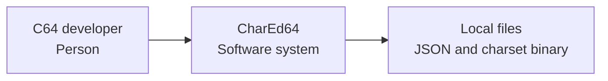
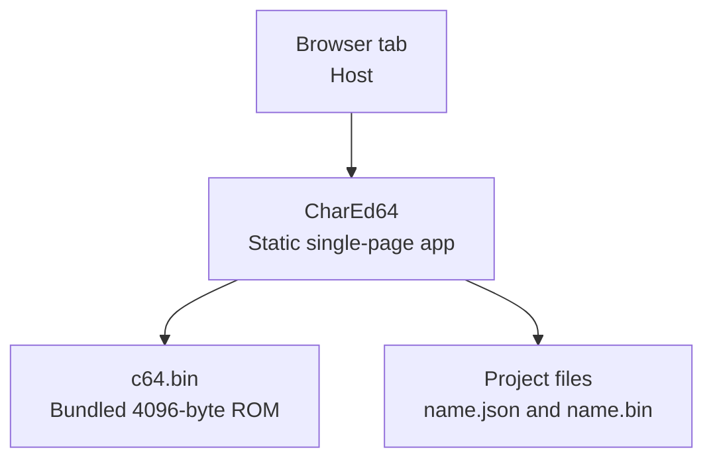
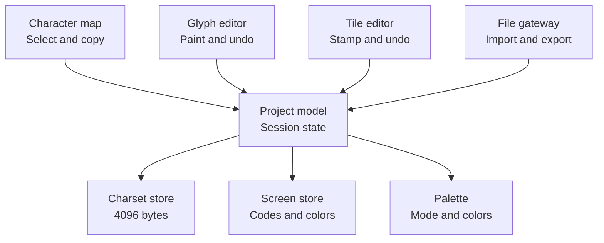

# CharEd64 plan

Working plan for a static browser editor that builds Commodore 64 character sets and a tile screen. Source: `initial-chared64-requirements.txt` and `c64.bin` (4096 bytes, both original sets).

A project holds 4096 charset bytes. The default tile screen is 40×25 characters. Three panels stay on screen together. Each project exports two files.

## Color model

Multicolor mode follows Commodore 64 multicolor text. Each pixel is a bit pair:

| Bit pair | Color |
| --- | --- |
| 00 | Background, global, register D021, colors 0–15 |
| 01 | Multicolor 1, global, register D022, colors 0–15 |
| 10 | Multicolor 2, global, register D023, colors 0–15 |
| 11 | Per-cell color, color RAM bits 0–2, colors 0–7 |

The character map and the glyph editor are not tile cells, so bit pair 11 is shown there with a preview color. That preview is also the color given to a new tile cell. Each tile cell stores its own color and can differ from the preview. Single-color cells use all 16 colors.

## Scope

CharEd64 lets one person design a 256-character set, flip between the two ROM banks, preview those characters on a screen, and export either a JSON project or a 4096-byte charset binary. The binary matches the layout of `c64.bin` so it can be used in a Commodore 64 programming project. The tile screen stays inside the JSON project.

A later version can add a PRG wrapper, mixed hires and multicolor cells on one screen, flip and rotate tools, and autosave. This version saves only when the user exports. Closing the tab drops unsaved work.

## Decisions

| Decision | Status | Plan |
| --- | --- | --- |
| Both ROM banks | From the brief | The upper/lower switch needs both sets stored. A project holds 4096 bytes. The active set is what the panels show. |
| Multicolor mapping | Confirmed | Bit pair 00 is background, 01 is multicolor 1, 10 is multicolor 2, and 11 is the per-cell color (0–7). |
| Tile size cap | Assumed | Width and height are in characters, default 40×25, each axis from 1 to 256. |
| Import restores the screen | Correction | The JSON stores tile characters and colors, so import restores them along with metadata and character bytes. |
| No server | From the brief | Static page. The browser reads `c64.bin` and downloads or opens the project files. |
| Whole screen uses one mode | From the brief | Single-color or multicolor applies to every cell. Bytes are reinterpreted on a mode switch, not converted. |
| Screen resize | Assumed | The top-left overlap is kept. New cells are screen code 32 and the default ink color. Cells outside the new size are dropped. Resize is not undoable. |
| Explicit save | From the brief | Persistence is export and import. Zoom, mode, bank, colors, and tile size are saved in the JSON. |

## C4

### Context

One developer, one web app, and files on the local disk. The original ROM is bundled inside CharEd64, so it is not a separate system.

### Containers

The browser runs a static single-page app. That app reads the bundled `c64.bin` when a project starts from the original sets, and it imports and exports project files on disk. There is no server.

### Components

The three panels and the file gateway all go through one project model. Glyph undo stays inside the glyph editor. Tile undo stays inside the tile editor. The charset, the screen, and the palette are the only stored data.

## Data

Each character is 8 bytes, top row first. In a byte, bit 7 is the leftmost single-color pixel. In multicolor mode the same byte is four pixels, pairs 7–6, 5–4, 3–2, and 1–0, and each pixel is drawn twice as wide. Characters 128–255 in the original ROM are reverse-video copies. The editor treats them as ordinary editable characters and does not regenerate the reverse.

### Project JSON

| Field | Contents |
| --- | --- |
| `name` | Project name. Export files are `name.json` and `name.bin`. |
| `mode` | `single` or `multi`. Changes how the same bytes are drawn. |
| `activeSet` | `upper` (bytes 0–2047) or `lower` (bytes 2048–4095). |
| `colors.background` | 0–15. Global background. Commodore register D021. |
| `colors.foreground` | 0–15. Ink for bit 1 on the map and in the glyph editor. |
| `colors.multi1` | 0–15. Bit pair 01. Register D022. |
| `colors.multi2` | 0–15. Bit pair 10. Register D023. |
| `colors.multiCell` | 0–7. Bit pair 11. Preview on the map and in the glyph editor, and the default color of a new tile cell. |
| `zoom.characters` | 1, 2, 4, 8, or 16. Default 4. CSS pixels per source pixel. |
| `zoom.editor` | 16, 32, 64, 128, or 256. Default 64. |
| `zoom.tiles` | Same choices as the character map. Default 2. |
| `tileSize` | `width` and `height` in characters. Default 40 and 25. Maximum 256 each. |
| `characters` | JSON array of 4096 numbers, each 0–255. Same order as `c64.bin`. |
| `tiles.chars` | Row-major screen codes. Length is width times height. Index `y × width + x`. |
| `tiles.colors` | Row-major color bytes, same length and order as `tiles.chars`. |

Defaults for a new project: background 6 (blue), foreground 14 (light blue), multicolor 1 is 1 (white), multicolor 2 is 2 (red), multi-cell preview is 7 (yellow). A cleared screen uses screen code 32, which is blank in the original ROM.

### Binary charset

`name.bin` is the 4096 character bytes and nothing else. The first 2048 bytes are the uppercase/graphics set. The next 2048 are the lowercase/uppercase set. Tile data, colors, and zoom stay in the JSON file.

## Requirements

### Project lifecycle

| ID | Requirement |
| --- | --- |
| FR-01 | New from original copies both 2048-byte banks from `c64.bin` into the project. |
| FR-02 | New blank project is 4096 zero bytes and a 40×25 screen of screen code 32. |
| FR-03 | The user names the project. That name is the export filename. |

### Mode and banks

| ID | Requirement |
| --- | --- |
| FR-04 | Single-color and multicolor can be switched at any time. Stored bytes stay as they are and are reinterpreted. |
| FR-05 | The active bank can be switched at any time. Edits belong only to the bank that was active when they were made. |
| FR-06 | The active bank and the color mode are shown on all three panels. |
| FR-07 | A bank switch redraws the tile screen with the new glyphs. Screen codes and cell colors stay put. |

### Colors

| ID | Requirement |
| --- | --- |
| FR-08 | Every swatch is one of the 16 Commodore 64 colors. |
| FR-09 | In single-color mode the glyph editor paints bit 0 or bit 1 on an 8×8 grid. Bit 0 is the global background. Bit 1 is the global foreground. |
| FR-10 | In single-color mode each tile cell stores its own foreground, 0–15. The character map and glyph editor use the global foreground. |
| FR-11 | In multicolor mode the glyph editor paints one of four slots on a 4×8 grid. Each slot is drawn two source pixels wide. |
| FR-12 | Multicolor bit pairs are 00 background, 01 multicolor 1, 10 multicolor 2, and 11 per-cell color. The per-cell value is 0–7. |
| FR-13 | A stored cell color above 7 is masked to the low 3 bits while multicolor mode is on, and the stored value is kept for a return to single-color mode. |
| FR-14 | Changing a global color updates every panel immediately, because colors are indexes, not pixels baked into the charset. |

### Character map

| ID | Requirement |
| --- | --- |
| FR-15 | The map shows the 256 characters of the active bank in a 16×16 matrix. |
| FR-16 | Clicking a character selects it, highlights it, opens it in the glyph editor, and arms it as the tile stamp. |
| FR-17 | The character marked for copy uses a second highlight, distinct from the selection. |
| FR-18 | Map zoom is 1×, 2×, 4×, 8×, or 16×. Default is 4×. The map scrolls inside its panel. |

### Glyph editor

| ID | Requirement |
| --- | --- |
| FR-19 | The glyph editor is placed to the right of the character map. |
| FR-20 | Editor zoom is 16, 32, 64, 128, or 256 CSS pixels per source pixel. Default is 64. The pane scrolls. |
| FR-21 | Copy marks the selected character. Paste writes that character’s 8 bytes into the character open in the editor. |
| FR-22 | Undo restores glyph-byte edits. It does not undo zoom, palette, bank, or mode. |
| FR-23 | Painting updates the editor immediately. The map and the tile panel catch up without dropping paint events, and they are current when the pointer is released. |

### Tile editor

| ID | Requirement |
| --- | --- |
| FR-24 | The tile panel opens at 40×25 characters. The user sets width and height, each from 1 to 256. |
| FR-25 | Resize keeps the overlapping top-left rectangle. New cells are screen code 32 and the default ink. Dropped cells are not restored by undo. |
| FR-26 | Tile zoom uses the same steps as the character map. Default is 2×. |
| FR-27 | The user switches between character-draw and color-draw, and between pen and area, independently. |
| FR-28 | Pen writes every cell the pointer crosses while the button is held. Area fills the rectangle from press to release. |
| FR-29 | Character-draw writes the armed character and the screen’s selected cell color. Color-draw writes that color and leaves the screen code unchanged. |
| FR-30 | Tile undo restores cell writes only. |

### Files

| ID | Requirement |
| --- | --- |
| FR-31 | JSON export writes `name.json` with the fields in the data section. Byte lists are JSON arrays of numbers. |
| FR-32 | Binary export writes `name.bin` as the 4096 character bytes, in `c64.bin` order. |
| FR-33 | Import replaces the open project with the file’s metadata, both character sets, and both tile arrays. |
| FR-34 | A file that fails validation leaves the open project unchanged and tells the user why. |

### Quality

| ID | Requirement |
| --- | --- |
| NFR-01 | The app is a static HTML page. It runs with no server and no account. |
| NFR-02 | The character map, glyph editor, and tile editor are visible at the same time. |
| NFR-03 | The layout shows the project name, the active bank, the color mode, the current tool, and the 16-color palette without opening a separate screen. |
| NFR-04 | A paint stroke on an 8×8 glyph stays responsive at every editor zoom, including 256. |

## Build order

| Step | Done when |
| --- | --- |
| 1. Project model | A session can hold both banks, the palette, and a 40×25 screen, and can draw one character from `c64.bin`. |
| 2. Character map | The active bank appears as a 16×16 matrix. Clicking a cell selects it. Zoom works. |
| 3. Glyph editor | The user can paint bits, undo, copy and paste, and see the map catch up after the stroke. |
| 4. Bank and color mode | Switching bank swaps glyphs. Switching mode reinterprets bytes. Global colors repaint every panel. |
| 5. Tile editor | Pen, area, character-draw, and color-draw work. Resize and tile undo work. Bank switch redraws the screen in place. |
| 6. Files | JSON round-trips the whole project. The binary export is 4096 bytes. A bad file does not clobber the session. |
| 7. Layout pass | All three panels, the palette, and the mode controls read as one professional screen. |

Step 4 is where the confirmed multicolor mapping becomes visible: bit pairs 00, 01, 10, and 11 are background, multicolor 1, multicolor 2, and the per-cell color.

## Implementation

Vanilla HTML, CSS, and ES modules, with no framework and no build step. The page is `index.html`. Canvas surfaces are the character map, the glyph editor, and the tile screen. `js/project.js` holds the charset, the screen, and undo. Open the folder through a static file server so the modules and `c64.bin` can load.
