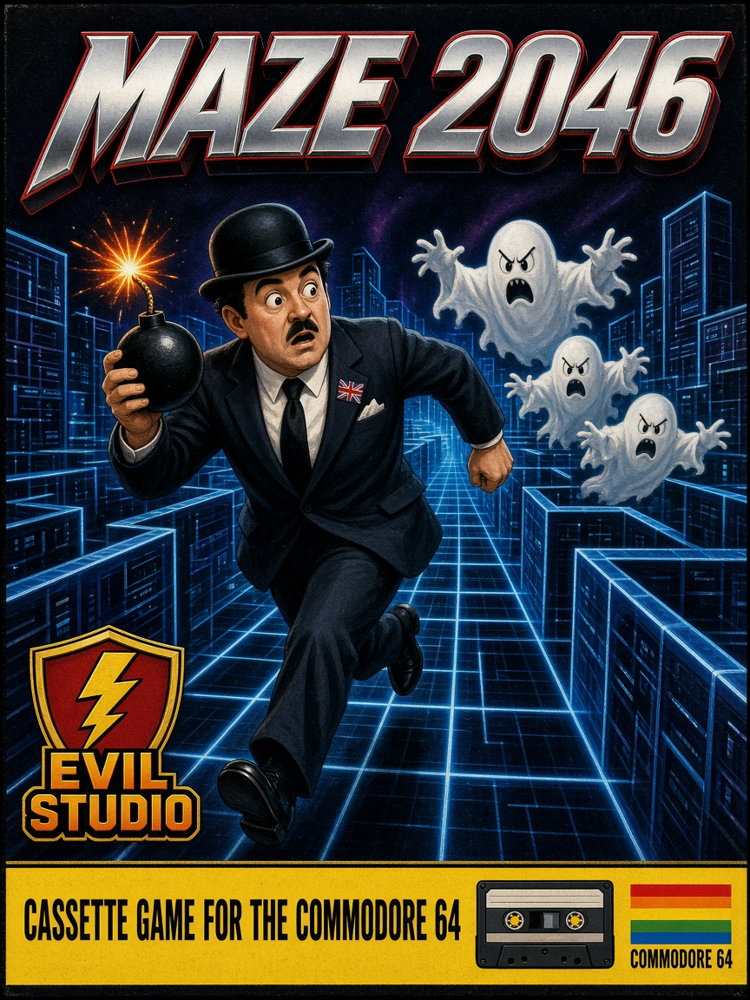

# Maze 2046



A cc65 cassette game for the Commodore 64, from Evil Studio. A small man walks a maze drawn with PETSCII graphics. The map is 160 by 100 characters. The top line is a status bar with the remaining time, how many diamonds are left, the score, and a row of hearts for life. The maze below fills the rest of the screen. The camera stays still while he walks. When he comes within five characters of an edge, movement locks and the view slides eight characters, one character at a time. He can walk again when the slide finishes.

Ten white diamonds are scattered on open floor. Each one is worth 10 points. Three red hearts are placed well apart around the maze. Taking a heart adds 20 points, and one life if the bar is not already full. A doubled sprite in the lower right shows where the remaining diamonds are, in white, with the player in yellow and the ghosts in red. Three bombs are shown on the status line. The fire button or the space bar plants one where he stands. The fuse burns for three seconds and the blast clears the eight squares around it. Blue border walls stay standing. A ghost in the blast turns black, stops for twenty seconds, and is worth 50 points. Standing in the blast costs a heart. Four ghosts each hunt in their own way: one follows, one waits ahead, one comes in from the side, and one trails behind until it is close. In the corridors they move at half his speed. Far away they cut through walls at a quarter of his speed. If the way to their target is blocked they peel off in different directions instead of stacking up. A ghost touch costs one heart of life. Steps, a collected diamond, a heart, a ghost hit, and the moment the last diamond is taken each have their own sound. The clock starts at five minutes, and life starts at ten hearts. The exit is a door of left arrows at the bottom right of the map. Reaching it after every diamond is collected runs the remaining time down quickly while a tone rises from low to high. Each second left is a point, and each bomb still held is worth 50. Running out of time ends the game too. When the last heart is lost a short sad tune plays and the screen says GAME OVER. A high score list follows, then the title comes back.

The title picture was drawn in [CharEd64](../chared64/README.md) and is stored in `maze2046.json`. The title and the high score list both say PRESS H FOR HELP. H opens the story on two pages. Fire or the space bar turns to the second page, and Q returns to the screen that was showing.

## Maze generator

The maze is a perfect maze. Every room can be reached from the start, and until a bomb breaks a wall there is exactly one route between any two rooms. That is why the corridors run long and twist.

The map is 160 by 100 characters, but the generator works on a grid of 39 by 24 rooms. Each room is a 3 by 3 block of floor, and a wall one character thick separates the rooms. Room column `cx` and row `cy` begin at character `1 + cx * 4` and `1 + cy * 4`. The spare characters around that grid stay wall, so the rooms never touch the edge of the map.

Generation fills the whole map with wall, carves the start room at `(0, 0)`, and pushes that room on a stack. From the room on top it looks up, down, left, and right. It picks an unvisited neighbor at random, knocks out the three wall characters between the two rooms, carves the new room, and pushes it. A room counts as open once the top-left character of its 3 by 3 is floor, so a passage is never opened into a room that has already been visited. That rule keeps the maze free of loops.

A room with no unvisited neighbor is a dead end. The generator pops it and continues from the room underneath. The stack is the corridor being dug, so a region is filled before the search leaves it. The stack is two arrays of 936 bytes rather than C recursion, because a corridor that visits every room would be too deep for the 6502 call stack. The loop ends when the stack is empty. All 936 rooms have been carved by then.

While the screen is blanked, each step copies the CIA timer into the border, which is the color cycling during the wait.

The exit then overwrites the 3 by 3 of the last room, `(38, 23)`, with left arrows. The outermost ring of the map is repainted as the darker blue shell. Bombs can break the light-blue inner walls, and that shell stays. Diamonds and hearts are placed only on floor the carve left behind.

## Build

cc65 (`cl65`) needs to be on `PATH`.

```
cd maze
make
```

This writes `maze.prg`.

## Run

With VICE installed as a Flatpak:

```
make run
```

Or point any C64 emulator at `maze.prg`.

The game opens on the Maze 2046 title. Press the fire button or the space bar to start, or H for the help pages. Generating the maze takes a few seconds on a real machine. The picture is switched off and the border cycles through random colors until it is ready, then the border goes black.

## Controls

- Joystick in port 1 or port 2
- `W` `A` `S` `D`
- Cursor keys

The man slides along walls. He cannot walk through them.
